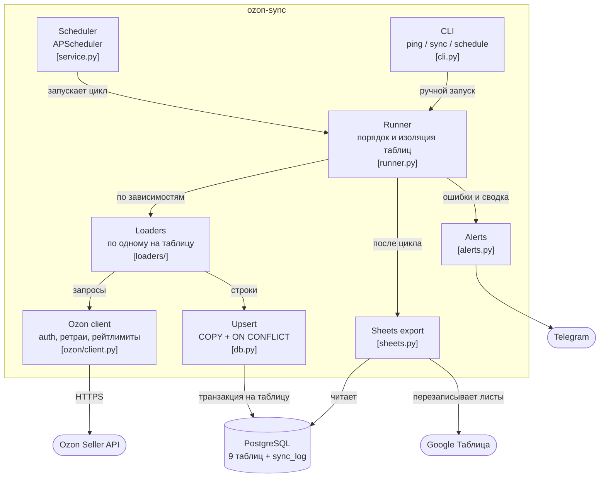

# OzonDBe

OzonDBe — сервис выгрузки данных магазина из Ozon Seller API в собственную базу PostgreSQL

Сервис по расписанию забирает склады, товары, цены, остатки и акции магазина,
складывает их в базу без дублей, ведёт журнал обновлений по каждой таблице,
выгружает остатки в Google Таблицу и сообщает об ошибках в Telegram

## Статус проекта

Учебный проект по реальному заказу с FL.ru. Работает с песочницей Ozon:
товары и остатки проверены на живых данных песочницы, остальные 7 таблиц —
на фикстурах из документации и сквозных тестах

## Возможности

На текущем этапе OzonDBe включает:

- выгрузку 9 таблиц из Ozon Seller API
- запуск по расписанию (по умолчанию 10:00, 14:00, 18:00 МСК) и вручную
- upsert без дублей: повторный запуск без изменений в кабинете не меняет ни одной строки
- пометку `is_deleted` для записей, пропавших из кабинета, вместо удаления
- хранение полного ответа API по каждой записи в колонке `raw jsonb`
- изоляцию ошибок: падение одной таблицы не останавливает остальные
- журнал запусков `sync_log` и представление `sync_status`
- выгрузку остатков и статуса синхронизации в Google Таблицу
- алерты и сводку цикла в Telegram
- работу как с боевым API, так и с песочницей Ozon

## Архитектура



### Цикл синхронизации

выглядит следующим образом:

```text
   Расписание / sync --all
           ↓
 Склады, товары, акции
           ↓
Способы доставки, цены, остатки,
 кандидаты и товары в акциях
           ↓
 Upsert + is_deleted + sync_log
           ↓
     Google Таблица
           ↓
  Алерты и сводка в Telegram
```

Зависимые таблицы берут ID из базы, а не из памяти. Если, например, товары упали,
цены и остатки всё равно обновятся по последней успешной загрузке товаров

Каждая таблица сначала целиком скачивается из API и только потом пишется в базу
в отдельной транзакции, поэтому недокачанная таблица не помечает записи удалёнными

## Таблицы

| Таблица                  | Данные                      | Метод API                                    | Ключ                     |
| ------------------------ | --------------------------- | -------------------------------------------- | ------------------------ |
| `ozon_warehouses`        | склады продавца             | `/v1/warehouse/list`                         | `warehouse_id`           |
| `ozon_delivery_methods`  | способы доставки складов    | `/v1/delivery-method/list`                   | `id`                     |
| `ozon_products`          | товары                      | `/v3/product/list` + `/v3/product/info/list` | `product_id`             |
| `ozon_product_prices`    | цены и комиссии             | `/v5/product/info/prices`                    | `product_id`             |
| `ozon_stocks_rfbs`       | остатки FBS/rFBS по складам | `/v1/product/info/stocks-by-warehouse/fbs`   | `sku + warehouse_id`     |
| `ozon_stock_management`  | остатки FBO/FBS             | `/v4/product/info/stocks`                    | `product_id + type`      |
| `ozon_actions`           | акции                       | `GET /v1/actions`                            | `action_id`              |
| `ozon_action_candidates` | товары, доступные для акции | `/v2/actions/candidates`                     | `action_id + product_id` |
| `ozon_action_products`   | товары в акции              | `/v2/actions/products`                       | `action_id + product_id` |

У каждой таблицы есть общие колонки: `raw`, `first_seen_at`, `updated_at`, `is_deleted`

Когда и с какой ошибкой обновлялась каждая таблица:

```sql
SELECT * FROM sync_status;
```

## Технологии

- Python 3.12
- httpx
- psycopg 3
- PostgreSQL 16
- Alembic
- APScheduler
- gspread
- structlog
- pytest, respx
- uv
- Docker, Docker Compose

## Запуск и Конфигурация

Перед любым запуском необходимо создать `.env` на основе `.env.example`:

```bash
cp .env.example .env
```

Запуск:

```bash
docker compose up -d --build
```

Контейнер `app` применяет миграции и запускает планировщик. Postgres наружу не публикуется.
`DATABASE_URL` и путь к ключу Google внутри контейнера задаются в `docker-compose.yml`,
значения из `.env` для них используются только при локальном запуске.
`.env` и `secrets/` в образ не копируются, ключ Google подключается томом только на чтение

Ручной запуск внутри контейнера:

```bash
docker compose exec app ozon-sync ping
docker compose exec app ozon-sync sync --all
docker compose exec app ozon-sync sync --table ozon_products
```

### Ozon

Переключение между песочницей и боевым API делается только конфигом:

```dotenv
OZON_ENV=prod
OZON_CLIENT_ID=...
OZON_API_KEY=...
```

Ключу достаточно роли `seller-api.admin-read-only`, сервис ничего не меняет в кабинете

Для песочницы нужен Client ID (UUID) и секрет OAuth-приложения:

```dotenv
OZON_ENV=sandbox
OZON_SANDBOX_CLIENT_ID=xxxxxxxx-xxxx-xxxx-xxxx-xxxxxxxxxxxx
OZON_SANDBOX_CLIENT_SECRET=...
```

В песочнице работают только `/v3/product/list` и `/v4/product/info/stocks`,
поэтому при `OZON_ENV=sandbox` синхронизируются только `ozon_products` (без названий,
только данные из списка товаров) и `ozon_stock_management`. Остальные таблицы пропускаются
без ошибок и алертов

Если Ozon сменил версию метода, путь можно подменить без правки кода:

```dotenv
OZON_METHOD_OVERRIDES={"/v1/warehouse/list": "/v2/warehouse/list"}
```

### Расписание и Telegram

```dotenv
SYNC_SCHEDULE=10:00,14:00,18:00
SYNC_TIMEZONE=Europe/Moscow
STALE_AFTER_HOURS=12
TELEGRAM_BOT_TOKEN=...
TELEGRAM_CHAT_ID=...
TELEGRAM_SUMMARY=true
```

### Google Таблица

1. Создайте сервис-аккаунт в Google Cloud и включите Google Sheets API
2. Скачайте JSON-ключ в `secrets/google-service-account.json`
3. Выдайте email сервис-аккаунта права редактора на таблицу
4. Укажите ID таблицы из её ссылки:

```dotenv
GSHEET_ID=...
```

Сервис перезаписывает листы «Остатки», «Остатки по складам» и «Статус синхронизации»

### Доступ к базе для аналитики

Если задан `ANALYTICS_RO_PASSWORD`, миграция создаёт пользователя `analytics_ro` только на чтение.
Пароль нужно задать до первого запуска: роль создаётся первой миграцией.
Если база уже создана, роль можно добавить вручную:

```sql
CREATE ROLE analytics_ro LOGIN PASSWORD '...';
GRANT USAGE ON SCHEMA public TO analytics_ro;
GRANT SELECT ON ALL TABLES IN SCHEMA public TO analytics_ro;
ALTER DEFAULT PRIVILEGES IN SCHEMA public GRANT SELECT ON TABLES TO analytics_ro;
```

## Что делать при алерте

- **❌ упало таблиц** — смотрите текст ошибки в алерте или в `sync_status`
  - `401` / `403` — ключ Ozon истёк или у него нет нужной роли
  - `404` — Ozon отключил версию метода: найдите новую в документации и задайте `OZON_METHOD_OVERRIDES`
  - `API вернул 0 записей` — Ozon вернул пустой список при непустой таблице, данные не тронуты. Проверьте кабинет и повторите `sync --table`
  - `429` после всех повторов — слишком частые запросы, разнесите расписание
- **⏰ не обновлялись дольше N ч** — таблица падает несколько запусков подряд или планировщик не работает: `docker compose logs app`
- **🔥 цикл упал целиком** — обычно недоступна база: `docker compose ps`, `docker compose logs db`
- **gsheet: ошибка** — нет доступа к таблице или ключ сервис-аккаунта не найден. База при этом обновлена

## Как добавить новую таблицу

1. Миграция в `migrations/versions/` с ключевыми колонками и общими `raw`, `first_seen_at`, `updated_at`, `is_deleted`
2. Загрузчик в `ozon_sync/loaders/`: функция `fetch(ctx)`, которая отдаёт словари с колонками и `raw`, и описание `Loader(table, key, columns, fetch, depends)`
3. Регистрация в `loaders.registry()`
4. Фикстура ответа API в `tests/fixtures/` и тест маппинга

## Разработка

```bash
uv sync --python 3.12
uv run pytest -q
```

Тесты не ходят в сеть. Тесты на базе запускаются, если задан `TEST_DATABASE_URL`, иначе пропускаются.
Postgres без Docker можно поднять так:

```bash
uv run --with pgserver python -c "import pgserver; print(pgserver.get_server('.pg', cleanup_mode=None).get_uri())"
```
